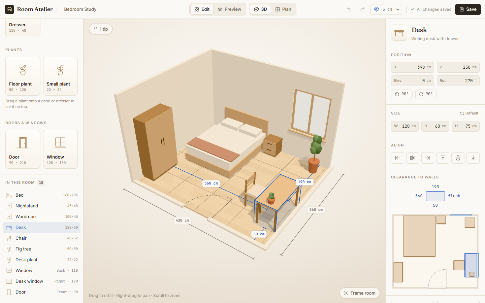
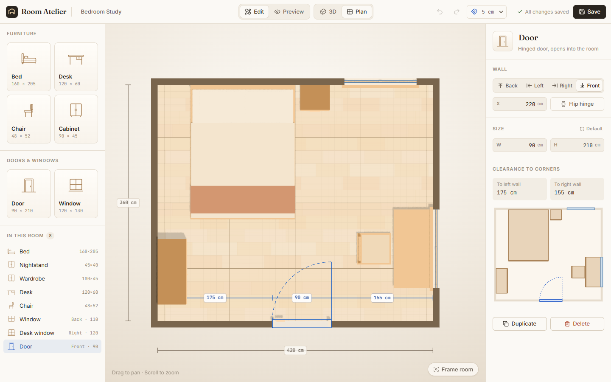
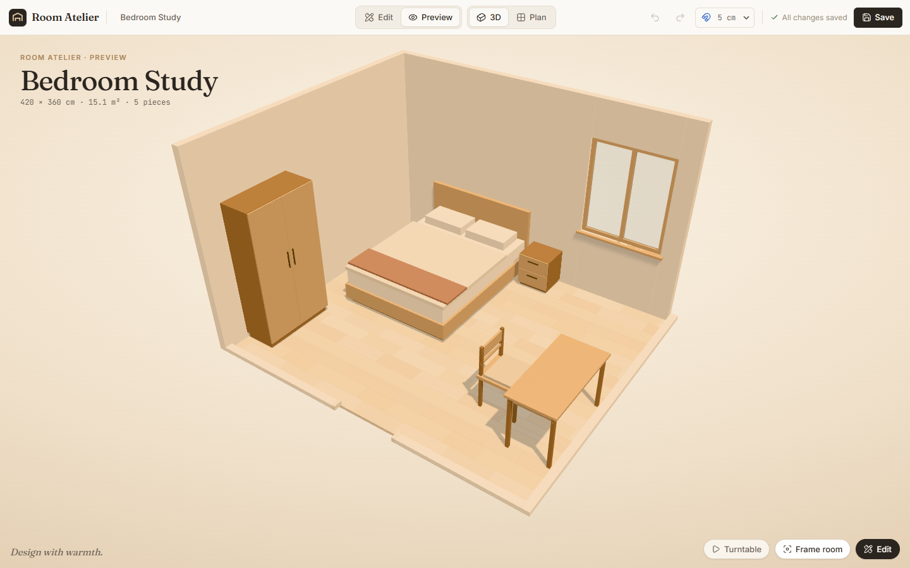

# Room Atelier

**Edit with precision. Design with warmth.**

A browser-based 3D room planner. In **Edit** mode it behaves like a small CAD tool: real-world dimensions, typed coordinates, grid and wall snapping, live clearance measurements. In **Preview** mode the panels fall away, the light turns warm, and you can just look at the room you made.



| Plan view | Preview |
| --- | --- |
|  |  |

## Features

- **Photo-inspired sunlit study.** The supplied reference is available as **阳光里的墨香与旅行手账** in the Rooms sidebar, or through `/?room=sunlit-study`. Opening that link appends a furnished room and consumes the URL command so refreshing does not add duplicates. Existing rooms are preserved, and the addition is undoable. Its 4.8 × 5.8 × 2.9 m dimensions are estimates from the image. The editable interpretation includes full-height bookcases, a central craft table, a calligraphy workbench, a reading chair and ottoman, a patterned rug, blue curtains and plants; fine artwork, outdoor scenery and the pet are not reproduced.
- **Multiple rooms.** Add and name rooms with independent dimensions, furniture, openings and color schemes. Switch between **Single room** and **Together** in either 3D or Plan view. In Together mode, drag rooms in the assembly plan, enter X/Z coordinates and rotation, or join a room to any side of another room. Exterior edges snap together; hold Alt for free placement. Overlapping rooms are flagged. Room creation, placement and deletion support undo/redo and autosave, and existing single-room saves migrate automatically.
- **Individual furniture colors.** Select a piece and use **Colors** in its properties to choose body, legs/base, textiles or hardware colors, depending on the model. Plants have pot and leaf colors too. Pick a color or enter a six-digit hex code. Custom colors belong to that piece, survive room-style changes, and are copied when duplicating; **Use defaults** returns it to the current room palette and model defaults. Color edits support undo/redo and autosave, and older saves keep their existing appearance.
- **Real-size rooms.** Enter width, depth and height in cm and the floor and walls are generated to match. Shrinking the room pulls furniture back inside.
- **Parametric furniture.** Bed, desk, chair, cabinet and dresser are built from code, so they stay correct at any size. A cabinet under 1 m gets drawers, a taller one gets doors, so the same type works as a nightstand or a wardrobe. The dresser's grid of drawers adapts to its size: two columns from 1 m wide, one row per ~20 cm of height.
- **Plants.** Floor and tabletop plants share one parametric model: tall ones grow a trunk, short ones stay bushy. Drag onto the visible top of a cabinet, bookcase, desk or dresser; suitable tops highlight green, the pot stays supported at edges, and dragging clearly past an edge returns it to the floor. Dragging follows the actual support height in both single and assembled rooms. Select a plant and use **Place on a surface** in Properties for direct placement (or return to an open floor spot). Only tops that fit the pot and leave enough ceiling clearance are offered. Hold Alt to bypass the grid for fine adjustments.
- **Color schemes.** Five curated palettes (Warm Oak, Nordic, Japandi, Mid-century, Plaster & Clay), switched in one click. Seven color roles (walls, floor, wood, dark wood, textiles, accent, hardware) can each be fine-tuned. Rule-based suggestions mark the palettes that suit the room, based on its floor area and how much window glass it has, and say why. Color tips flag furniture that blends into the walls, or dark walls in a small or dim room.
- **Layout check.** A rule-based "linter" for rooms, with no AI. It flags overlapping pieces, blocked door swings, tall furniture in front of windows, desks without room for a chair, and drawers or doors with no space to open. It also gives softer tips: a tight side of the bed, or a desk or plant far from daylight. Every message includes the measured numbers, and clicking it jumps to the piece to move. Pieces with warnings are outlined in amber.
- **Doors and windows.** Add them from the library, drag them along a wall or onto a different wall, and set width, height and sill height precisely. Walls are split around each opening, with no boolean geometry. Doors show their swing arc on the floor, so you can see what space to keep clear. In plan view, walls are cut at 1.2 m like an architectural floor plan, so windows show as the classic double line.
- **Camera.** Orbit, pan and zoom in 3D. Switch to an orthographic **Plan** view for a true floor plan. Walls between the camera and the room cut away automatically.
- **Select and move.** Click to select, then drag across the floor. Snapping goes to a 1, 5 or 10 cm grid, and edges within 6 cm of a wall stick flush to it. Hold Alt to move freely.
- **Precise properties.** Position, elevation, rotation and size are all editable in cm. Fields accept units and simple sums (`1.2m`, `450mm`, `120+35`). You can also drag a field's label to scrub the value, or use ↑/↓ to step it.
- **Measure and align.** The selected piece shows dimension lines to all four walls. A selected door or window shows a chain dimension along its wall (corner → opening → corner). There's a clearance readout and a live SVG plan, plus one-click alignment to any wall or to the room's center line.
- **Undo / redo.** One drag or one scrub counts as one undo step, and a burst of arrow-key nudges merges into one step.
- **Save and load.** Changes autosave to `localStorage` (debounced), and Ctrl+S saves right away. Saved data is checked on load, so a hand-edited or corrupted save falls back safely.

Out of scope for v1: AI layout, accounts, backend, photoreal rendering, collision detection (furniture can overlap a window or a door swing), CAD import.

## Getting started

```bash
npm install
npm run dev      # http://localhost:5173
npm test         # unit tests (geometry, persistence, store, input parsing)
npm run build    # type-check + production build
```

### Working with multiple rooms

1. Choose **Add room** in the left sidebar. Select a room there or from the canvas dropdown to edit its contents. Click its name in the properties panel to rename it.
2. Choose **Single room** to view only that room. Choose **Together** to see the assembled project. Both work in Edit and Preview modes.
3. In Together/Edit mode, deselect furniture to see **Arrange rooms**. Drag any room in the small plan, use the X/Z and rotation fields, or choose a neighbor and click Left/Back/Front/Right. Focus a room in the small plan and use arrow keys for 1 cm nudges, or Shift+arrows for 10 cm.
4. Use **Frame all** (F) after precise placement to fit the entire layout. Each room keeps its furniture and openings in local coordinates when moved or rotated.

To add the reference study, click its image card below the room list. The new bookcase, craft table, armchair, ottoman, rug and curtain models also appear in the furniture library and support individual colors. Craft-table height includes its desktop tools; plants sit on the tabletop 16 cm below that total height. Rugs and curtains are excluded from circulation checks and floor-coverage totals.

Joining positions complete rooms with their exterior walls touching. It preserves their individual walls and openings; it does not automatically cut connecting doors. The room selected in the sidebar determines which room receives new furniture and which room the layout checks describe.

Projects save in the version 2 format under `room-atelier:layout:v2`. On first load, a version 1 save is wrapped in a single room at the origin; the old storage entry is preserved as a backup.

## Architecture

```
React + TypeScript UI ─── Toolbar · Library · Properties panel
          │  read state / call actions
          ▼
Zustand editor store ──── room · furniture · selection · history   ← single source of truth
          │  read state                         │ debounced
          ▼                                     ▼
React Three Fiber scene ─ Canvas · meshes       localStorage
          │
Geometry utilities ────── footprints · clamping · snapping · measuring (pure functions, unit-tested)
          │
Three.js / WebGL
```

**The rule that holds it together: furniture data lives in the store, never in Three.js meshes.**
Dragging a chair in the canvas and typing its X coordinate in the panel are the same call, `updateFurniture(id, { position })`. The store enforces the invariants (inside the room, sizes within limits, mm precision), and the 3D scene, the outliner and the SVG plan all re-render from that one copy of the data.

### Units and coordinates

- 1 Three.js unit = 1 meter. The UI shows centimeters.
- Y is up. Each room's back-left floor corner is its local origin, so furniture X reads as "distance from the left wall" and Z as "distance from the back wall". A room also has an independent world X/Z position and Y rotation for assembly; Single room view ignores that transform without changing it.
- `position` is the center of the furniture's footprint. `rotation` is in degrees around Y (counter-clockwise seen from above).
- An opening's `offset` is its center along its wall, in the same coordinates: an X value on the back and front walls, a Z value on the side walls.

### Project structure

```
src/
  types.ts                 data model (Furniture, Room, Layout)
  lib/
    catalog.ts             furniture types, default sizes, limits
    geometry.ts            footprint math, clamping, snapping, alignment
    polygon.ts             2D overlap (separating axis test) and ray casting on the floor plane
    layoutChecks.ts        the layout and color check rules
    palettes.ts            palette presets, color contrast math, palette suggestions
    openings.ts            door/window catalog, wall coordinates, splitting walls around openings
    persistence.ts         localStorage load/save with validation
  store/
    editorStore.ts         Zustand store: state, actions, undo/redo
    autosave.ts            debounced persistence
  scene/                   everything inside <Canvas>
    Viewport.tsx           canvas setup
    CameraRig.tsx          perspective / plan cameras + OrbitControls
    RoomShell.tsx          floor + walls, cutaway animation
    ClippedBox.tsx         a wall piece that clips itself to the wall's current height
    wallParts.ts           frame, glass, leaf and handle boxes for each opening
    OpeningItem.tsx        one door/window: parts, hit box, swing arc, plan symbol
    FurnitureItem.tsx      one piece: transform, hover, selection
    useFurnitureDrag.ts    raycast-to-floor dragging
    useOpeningDrag.ts      raycast-to-wall dragging
    Measurements.tsx       CAD-style dimension lines
    ScreenLabel.tsx        HTML label pinned to a 3D point
    models/                parametric Bed, Desk, Chair, Cabinet, Dresser, Plant
  components/              toolbar, library, properties panel, style picker, SVG plan
```

## Reading the code (new to 3D?)

If you're new to 3D programming, this order goes from the basics to the interactions:

1. **`scene/models/Box.tsx` → `models/Desk.tsx`**: a mesh is a geometry (shape) plus a material (surface). Every piece of furniture is a handful of positioned boxes.
2. **`scene/FurnitureItem.tsx`**: a `<group>` moves and rotates its children together. This is where data (meters, degrees) becomes a transform (position, radians).
3. **`scene/Lights.tsx`**: hemisphere light for soft fill plus a directional "sun" for shadows.
4. **`scene/CameraRig.tsx`**: perspective vs. orthographic cameras, and what OrbitControls does.
5. **`scene/RoomShell.tsx`**: `useFrame` runs every frame. Mutate meshes directly here; don't go through React state.
6. **`scene/useFurnitureDrag.ts`**: raycasting turns a 2D mouse position into a 3D point on the floor. Most editor interaction is built on this.
7. **`scene/ScreenLabel.tsx`**: the reverse, projecting a 3D point onto the 2D screen.
8. **`lib/openings.ts` → `scene/ClippedBox.tsx`**: holes in walls without CSG. The wall is split into boxes around each opening, and each box clips itself to the wall's animated height.
9. **`scene/useOpeningDrag.ts`**: the same raycasting idea, but against vertical wall planes instead of the floor.
10. **`scene/materials.ts` → `applyPalette`**: every mesh shares a handful of material objects, so recoloring the room is a few `color.set()` calls, with no re-render and no new geometry. The floor texture holds only the plank variation, and the material color tints it.
11. **`lib/layoutChecks.ts`**: once the data is clean, design rules turn into short functions. Overlap uses the separating axis test, and clearance is measured by casting 2D rays.
